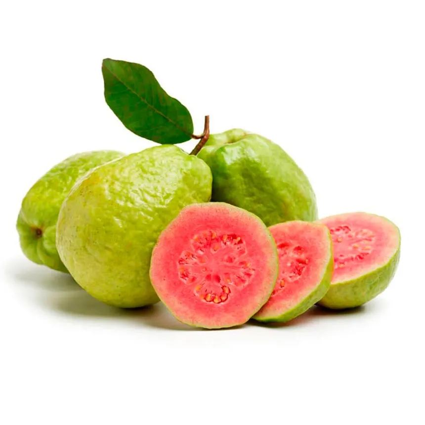

<p align="center">
  <picture>
    <source media="(prefers-color-scheme: dark)" srcset="assets/images/logo-horizontal-dark.png">
    
  </picture>
</p>

<p align="center">
  <strong>Del campo a cada embarque.</strong><br>
  Una operación de empaque de guayaba más clara, conectada y trazable.
</p>

<p align="center">
  Prototipo de interfaz · Web y móvil · Datos de demostración
</p>

---

## ¿Qué es GuavaLink?

GuavaLink busca digitalizar el trabajo de un **empaque de guayaba de exportación**. Su objetivo es reunir en un mismo flujo a productores, personal de recepción y administración: desde el origen de la fruta y su llegada al empaque hasta los embarques, pagos y reportes.

La propuesta contempla una experiencia web para la oficina y una experiencia móvil para el campo y el patio de recepción. En una etapa posterior, ambas compartirán información mediante una API y una base de datos centralizada. Este repositorio contiene **el prototipo de la interfaz**, desarrollado como una aplicación Expo que puede ejecutarse en web y dispositivos móviles.

<p align="center">
  
</p>

## Para quién está pensado

| Rol | Experiencia prevista | Qué necesita hacer |
| --- | --- | --- |
| **Administrador** | Web y tablet | Consultar indicadores; gestionar productores, huertas, embarques, pagos, reportes y accesos. |
| **Empacador / recepción** | Móvil | Identificar productores, registrar cajas y kilos recibidos, anotar incidencias y relacionar entregas con embarques. |
| **Productor** | Móvil | Mostrar su código QR y consultar entregas, pagos y avisos. |

## Qué incluye el prototipo

El acceso de prueba reconoce tres correos y abre una vista distinta para cada rol. La vista administrativa tiene un menú adaptable a escritorio y móvil; las vistas de productor y empacador son resúmenes iniciales que se ampliarán conforme avance el proyecto.

| Área | Disponible ahora |
| --- | --- |
| **Inicio de sesión** | Selección de rol mediante cuentas ficticias y regreso al login al cerrar sesión. |
| **Resumen administrativo** | Indicadores, gráfica de recepción y embarques de ejemplo. |
| **Productores** | Consulta, búsqueda y formularios de registro y edición con estado local. |
| **Huertas** | Registro, consulta y ubicación de huertas; mapa interactivo en web y representación simplificada en móvil. |
| **Recepción** | Registro de fruta pendiente de validación, con incidencia categorizada y severidad. |
| **Embarques** | Asignación posterior de recepciones validadas y avance secuencial de estado. |
| **Pagos** | Validación de kilos/precio y creación de pagos ligados a recepciones. |
| **Reportes** | Reportes de Supabase con filtros por fechas, productor, embarque y estado. |
| **Usuarios y roles** | Interfaz de gestión local para cuentas de demostración. |

> **Estado actual:** el login continúa en modo demostración. Las pantallas de operación conectadas guardan y consultan datos en Supabase, pero no hay autenticación real ni permisos por usuario. Las cuentas del módulo «Usuarios y roles» todavía no controlan el acceso al login.

## Tecnologías utilizadas

La interfaz está construida con estas herramientas:

| | Tecnología | Uso en GuavaLink |
| :---: | --- | --- |
|  | **Expo** | Desarrollo y ejecución de la aplicación en web, Android e iOS. |
|  | **React Native + React** | Componentes y pantallas compartidas entre dispositivos. |
|  | **Expo Router** | Navegación y organización de las rutas. |
|  | **TypeScript** | Tipos para componentes, datos y estados. |
|  | **NativeWind** | Estilos de utilidad para la interfaz. |
|  | **Leaflet** | Mapa interactivo de huertas en la versión web. |

> **Backend:** la aplicación utiliza Supabase con PostgreSQL para los módulos conectados. La autenticación y el control de acceso reales quedan fuera del alcance actual.

### Migraciones de base de datos

Los cambios de esquema están en [`supabase/migrations/`](supabase/migrations/). Aplícalos una sola vez y en orden en el SQL Editor de Supabase. Las migraciones `202610180001_traceability.sql`, `202610180002_reception_payments.sql` y `202610180003_payment_workflow.sql` habilitan trazabilidad, validación de recepciones y pagos ligados a una o varias recepciones. La migración `202610180004_operational_workflow.sql` agrega incidencias estructuradas y reglas para validar recepciones, asignarlas una sola vez y avanzar embarques.

El flujo operativo esperado es: registrar recepción sin embarque → validar kilos aceptados y precio en Pagos → asignar la recepción validada a un embarque en preparación/listo → avanzar el embarque de forma secuencial. Las incidencias históricas de texto se conservan y se copian a la tabla `reception_incidents` como tipo «Otro» cuando no tienen una categoría. El proyecto sigue usando cuentas demo; esta migración no agrega autenticación ni políticas RLS.

## Probar los tres roles

En el login puedes elegir uno de estos correos. Las cuentas y contraseñas son solo para la demostración; no uses credenciales personales.

| Correo | Vista que abre |
| --- | --- |
| `admin@gmail.com` | Panel de administración |
| `productor@gmail.com` | Vista inicial del productor |
| `empacador@gmail.com` | Vista inicial del empacador |

La asignación de roles para la demostración se gestiona mediante cuentas ficticias y datos locales/de prueba; no representa un sistema de autenticación para producción.

## Ejecutar el proyecto

Necesitas **Node.js** y **npm**. Desde la carpeta `GuavaLink`:

```bash
npm ci
npm run web
```

Para iniciar Expo y elegir otro destino de desarrollo:

```bash
npm start
```

Comprobaciones disponibles:

```bash
npx tsc --noEmit
npm run lint
```

La revisión completa de lint todavía señala un error previo en `src/hooks/use-color-scheme.web.ts` y advertencias en los componentes del mapa.

## Organización del código

```text
GuavaLink/
├── assets/                  Marca e imágenes usadas por la aplicación
├── src/
│   ├── app/                 Entrada y configuración de Expo Router
│   ├── components/          Mapa, gráfica, iconos y vistas compartidas
│   ├── data/                Cuentas ficticias para probar los roles
│   ├── screens/             Login y secciones de cada rol
│   ├── styles/              Estilos de las vistas
│   └── types/               Tipos compartidos
└── README.md
```

Los recursos de marca disponibles en este repositorio están en [`assets/images/`](assets/images/). El símbolo **G con hoja** y los verdes identifican a GuavaLink; la interfaz actual utiliza superficies oscuras y acciones azules para mantener el contenido legible.

<p align="center">
  
</p>

## Próximas etapas

1. **Pruebas integrales:** verificar el flujo entre recepción, validación, embarque y pago con datos de prueba.
2. **Seguimiento de incidencias:** agregar revisión/resolución y consulta del historial de incidencias.
3. **Trazabilidad del productor:** completar historial y avisos del productor sobre entregas y pagos.
4. **Preparación para producción:** definir autenticación, permisos, RLS y respaldos cuando el equipo apruebe salir del modo demo.

El alcance original y los criterios de diseño están documentados por separado en el material de planificación del proyecto.
